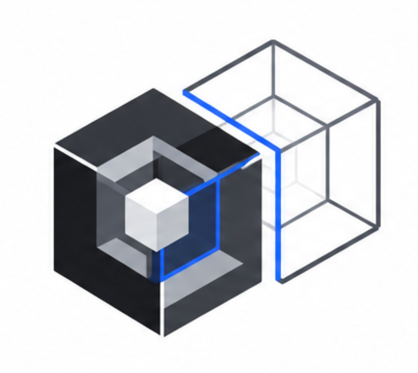

<div align="center">

<!-- LOGO -->


# 🛡️ NeuroSyn Sentinel Twin

<!-- ANIMATED TYPING HEADER -->
<a href="https://git.io/typing-svg">
  
</a>

<br/>

[](https://opensource.org/licenses/Apache-2.0)
[](https://python.org)
[](https://fastapi.tiangolo.com)
[](https://nextjs.org)
[-4285F4.svg?style=for-the-badge&logo=google&logoColor=white)](https://ai.google.dev/gemma)
[](https://docker.com)
[](https://networkx.org)
[](https://github.com/Muaviatanveer/sentinental-twin)

<br/><br/>

> 🧬 **An AI-native digital twin for container infrastructure that models multi-relationship network topology, predicts security blast radius using Gemma 4 Thinking Mode, and verifies counterfactual reachability policies in disposable, isolated Docker sandboxes.**

<br/>

[🚀 Quick Start](#-quickstart) · [📖 How It Works](#-how-it-works) · [🎯 Demo Fixtures](#-live-hackathon-demonstration-fixtures) · [🧪 Tests](#-automated-qa-suite) · [👥 Contributors](#-core-contributors--team) · [📄 License](#-license)

</div>

---

## 🎬 How It Works

<table>
<tr>
<td width="50%">

### 🔴 Before Sentinel Twin

```
┌─────────────────────────────┐
│     FLAT DOCKER NETWORK     │
│  ┌──────┐  ┌─────┐  ┌───┐  │
│  │ Web  │──│ API │──│DB │  │
│  │      │──────────▶│   │  │ ← DIRECT ACCESS! 💀
│  └──────┘  └─────┘  └───┘  │
│   Everything talks to       │
│   everything. Zero isolation│
└─────────────────────────────┘
```
⚠️ Frontend can directly reach the database  
⚠️ No network segmentation  
⚠️ Lateral movement is trivial  

</td>
<td width="50%">

### 🟢 After Sentinel Twin

```
┌─────────────────────────────┐
│   SEGMENTED DOCKER NETWORK  │
│  ┌──────┐    ┌─────┐       │
│  │ Web  │───▶│ API │       │
│  │      │ ✕  └──┬──┘       │
│  └──────┘    ┌──▼──┐       │
│   BLOCKED ✕  │ DB  │       │
│              └─────┘       │
│   Least-privilege enforced  │
│   by Gemma 4 + live probes  │
└─────────────────────────────┘
```
✅ Frontend → API only (port 8000)  
✅ API → DB only (port 5432)  
✅ Frontend ✕ DB **DENIED** — verified live  

</td>
</tr>
</table>

<br/>

<div align="center">
  <a href="https://git.io/typing-svg">
    
  </a>
</div>

<br/>

---

## ⚡ The Problem

Modern microservice architectures built on Docker Compose and Kubernetes often suffer from **flat network sprawl**:

<table>
<tr>
<td>🔓</td>
<td><b>Unrestricted Access</b></td>
<td>Frontend containers share default bridge networks with sensitive databases and payment vaults</td>
</tr>
<tr>
<td>🎯</td>
<td><b>Blind Changes</b></td>
<td>Network boundary modifications are made without real verification, risking outages or lateral movement</td>
</tr>
<tr>
<td>📋</td>
<td><b>Static Audits</b></td>
<td>Security relies on linters or synthetic mocks rather than <i>real</i> container runtime verification</td>
</tr>
</table>

---

## 💡 The Solution

Sentinel Twin creates an **executable digital twin** from any Docker Compose configuration and verifies security policies with **live container probes**:


<details>
<summary><b>🔍 Click to expand: 6-Stage Pipeline Deep Dive</b></summary>

<br/>

| Stage | Component | What It Does |
|:-----:|:---------:|:-------------|
| **1** | **Compose Parser** | Ingests arbitrary YAML, normalizes service definitions, flags insecure host bindings (`0.0.0.0:port`) |
| **2** | **Graph Engine** | Builds NetworkX MultiDiGraph with typed edges: `shared_network`, `published_port`, `depends_on` |
| **3** | **Gemma 4 Adapter** | Sends full topology context to Gemma 4 26B A4B with Thinking Mode; captures reasoning traces + latency |
| **4** | **Counterfactual Simulator** | Computes baseline reachability matrix **R₀**, applies policies, computes candidate **R₁**, outputs **ΔG = G₁ − G₀** |
| **5** | **Sandbox Runner** | Strips host bindings, provisions isolated Docker namespace, runs live `nc -zv` TCP probes per test case |
| **6** | **Evidence Collector** | SHA-256 hashes all execution artifacts, generates Markdown + JSON reports with unified YAML diffs |

</details>

---

## 🚀 Architecture & Tech Stack

```
sentinental-twin/
├── 🧠 engine/                    # Python backend engine
│   ├── compose_parser/           # YAML ingestion & security linting
│   ├── graph_engine/             # NetworkX multi-relationship graph builder
│   ├── policy_engine/            # Gemma 4 adapter (Studio / Ollama / Fallback)
│   │   └── gemma_adapter.py      # Live inference with thinking traces
│   ├── experiment_planner/       # Test plan generator from policy requirements
│   ├── sandbox_runner/           # Isolated Docker Compose sandbox orchestrator
│   ├── evidence/                 # SHA-256 cryptographic evidence collector
│   └── twin_builder/             # Digital twin constructor
│
├── 🌐 apps/
│   ├── api/                      # FastAPI REST API (Python 3.11+)
│   │   ├── app/
│   │   │   ├── api/              # Routers: projects, experiments, health
│   │   │   ├── services/         # Business logic: project, experiment, report
│   │   │   ├── models/           # SQLAlchemy ORM entities
│   │   │   └── schemas/          # Pydantic request/response contracts
│   │   └── tests/                # 4-level pytest suite
│   │
│   └── web/                      # Next.js 14 React dashboard
│       ├── app/
│       │   ├── projects/
│       │   │   ├── new/          # Screen B: Upload & Create Project
│       │   │   └── [id]/
│       │   │       ├── topology/ # Screen C: Interactive Graph Canvas
│       │   │       ├── experiments/
│       │   │       │   └── new/  # Screen D: Experiment Builder
│       │   │       └── reports/  # Screen F: Evidence Report Viewer
│       │   └── settings/         # Screen G: Gemma Configuration
│       ├── components/           # Reusable UI components
│       └── lib/                  # API client, types, utilities
│
└── 🎯 fixtures/                  # Real demo applications
    ├── real-commerce-app/        # 3-tier Flask + FastAPI + PostgreSQL
    ├── commerce-app/             # Standard e-commerce fixture
    └── fintech-enterprise/       # PCI-DSS banking architecture
```

<table>
<tr>
<th>Layer</th>
<th>Technology</th>
<th>Purpose</th>
</tr>
<tr>
<td>🧠 AI Engine</td>
<td><b>Gemma 4 26B A4B (MoE)</b></td>
<td>Thinking Mode policy synthesis with 256K context, step-by-step reasoning traces, latency telemetry</td>
</tr>
<tr>
<td>📊 Graph Engine</td>
<td><b>NetworkX</b></td>
<td>MultiDiGraph topology modeling with typed edges, reachability matrices, counterfactual diffs</td>
</tr>
<tr>
<td>⚡ API</td>
<td><b>FastAPI + SQLAlchemy</b></td>
<td>Async REST API with SQLite persistence, Pydantic contracts, auto-generated OpenAPI docs</td>
</tr>
<tr>
<td>💻 Frontend</td>
<td><b>Next.js 14 + React</b></td>
<td>Interactive topology canvas (@xyflow/react), execution workspace, report viewer</td>
</tr>
<tr>
<td>🐳 Sandbox</td>
<td><b>Docker Compose</b></td>
<td>Isolated disposable namespaces with host binding stripping and guaranteed teardown</td>
</tr>
<tr>
<td>🔒 Evidence</td>
<td><b>SHA-256 + Markdown/JSON</b></td>
<td>Cryptographic integrity hashes, unified YAML diffs, exportable verification reports</td>
</tr>
</table>

---

## 📦 Quickstart

### Prerequisites

| Requirement | Version | Why |
|:-----------:|:-------:|:----|
| 🐍 Python | 3.11+ | Backend engine & FastAPI |
| 📦 Node.js | 18+ | Next.js frontend |
| 🐳 Docker Desktop | Latest | Sandbox runner & demo fixtures |
| 🤖 Ollama *(optional)* | Latest | Local Gemma 4 inference |

### 1️⃣ Clone & Configure

```bash
git clone https://github.com/Muaviatanveer/sentinental-twin.git
cd sentinental-twin
cp .env.example .env
```

### 2️⃣ Start Backend API

```bash
python3 -m venv .venv
source .venv/bin/activate
pip install -r apps/api/requirements.txt
uvicorn apps.api.app.main:app --host 0.0.0.0 --port 8000 --reload
```

### 3️⃣ Start Frontend Dashboard

```bash
cd apps/web
npm install
npm run dev
```

### 4️⃣ Open in Browser

```
🌐 Frontend Dashboard  →  http://localhost:3000
⚡ API Documentation    →  http://localhost:8000/docs
❤️ Health Check         →  http://localhost:8000/api/v1/health
```

---

## 🧠 Gemma 4 Integration

Sentinel Twin supports **three Gemma provider modes** — configure via `.env`:

<table>
<tr>
<th>Mode</th>
<th>Config</th>
<th>Best For</th>
</tr>
<tr>
<td>☁️ <b>Google AI Studio</b></td>
<td><code>GEMMA_PROVIDER=google_ai_studio</code></td>
<td>Production — highest quality, requires API key</td>
</tr>
<tr>
<td>🏠 <b>Local Ollama</b></td>
<td><code>GEMMA_PROVIDER=ollama</code></td>
<td>Offline / hackathon demo — runs on your machine</td>
</tr>
<tr>
<td>🔄 <b>Deterministic Fallback</b></td>
<td><code>GEMMA_PROVIDER=deterministic_fallback</code></td>
<td>Testing — regex-based, no GPU required</td>
</tr>
</table>

<details>
<summary><b>🔧 Setting up Local Ollama with Gemma 4</b></summary>

```bash
# Install Ollama
curl -fsSL https://ollama.com/install.sh | sh

# Pull Gemma 4 model
ollama pull gemma4:26b

# Update .env
GEMMA_PROVIDER=ollama
OLLAMA_BASE_URL=http://localhost:11434
OLLAMA_MODEL=gemma4:26b
```

</details>

<details>
<summary><b>☁️ Setting up Google AI Studio</b></summary>

```bash
# Get API key from https://aistudio.google.com/apikey

# Update .env
GEMMA_PROVIDER=google_ai_studio
GOOGLE_AI_STUDIO_API_KEY=your-key-here
GOOGLE_AI_STUDIO_MODEL=gemma-4-26b-a4b-it
```

</details>

### 🎯 What Gemma 4 Does in the Pipeline

```
📄 Full Topology Context (services, networks, edges, ports)
          │
          ▼
    ┌─────────────┐
    │  Gemma 4    │  ← Thinking Mode enabled
    │  26B A4B    │  ← 256K context window
    │  (MoE)      │  ← Step-by-step reasoning
    └─────┬───────┘
          │
          ▼
    ┌─────────────────────────────────────┐
    │  Structured Policy Output:          │
    │  • allow/deny rules                 │
    │  • network segmentation proposals   │
    │  • architectural reasoning          │
    │  • confidence scores                │
    │  • inference latency (ms)           │
    └─────────────────────────────────────┘
```

---

## 🎯 Live Hackathon Demonstration Fixtures

### 🛒 Real E-Commerce App (`fixtures/real-commerce-app/`)

A **3-tier production-realistic** application demonstrating the security problem:

```
┌──────────────┐    ┌──────────────┐    ┌──────────────┐
│  🌐 Flask    │    │  ⚡ FastAPI  │    │  🐘 Postgres │
│  Frontend    │───▶│  API Server  │───▶│  Database    │
│  :5001       │    │  :8080       │    │  :5432       │
│              │    │              │    │              │
│  /direct-db  │────────────────────────▶ VULN! 💀    │
│  route       │    │              │    │  products    │
└──────────────┘    └──────────────┘    └──────────────┘
                                          │
                                     Seeded with
                                     real product data
```

> **The vulnerability**: Flask frontend has a `/direct-db` route that bypasses the API and connects to PostgreSQL directly — exactly the kind of flat-network flaw Sentinel Twin detects and fixes.

### 🏦 Fintech Enterprise (`fixtures/fintech-enterprise/`)

A **multi-service banking architecture** with PCI-DSS isolation boundaries:

```
┌─────────┐    ┌──────┐    ┌────────┐    ┌─────────┐
│ API     │───▶│ Auth │    │ Orders │    │ Payment │
│ Gateway │    │ Svc  │    │ Svc    │───▶│ Vault   │
│ :8080   │    │:8081 │    │ :8082  │    │ :8083   │
└─────────┘    └──────┘    └────────┘    └─────────┘
     │              │           │              │
     └──────────────┴───────────┴──────────────┘
            PCI-DSS Network Boundaries
```

---

## 🧪 Automated QA Suite

Sentinel Twin features a rigorous **4-level test pyramid**:

```
                    ┌───────────────────┐
                    │   Level 4: E2E    │  ← Full API workflow
                    │   API Flow        │
                ┌───┴───────────────┴───┐
                │   Level 3: Policy     │  ← Gemma adapter + conflicts
                │   Engine              │
            ┌───┴───────────────────┴───┐
            │   Level 2: Graph Engine   │  ← NetworkX reachability
            │   Reachability            │
        ┌───┴───────────────────────┴───┐
        │   Level 1: Compose Parser     │  ← YAML parsing + security
        │   & Security Linter           │
        └───────────────────────────────┘
```

```bash
# Run all tests
PYTHONPATH=. pytest apps/api/tests/test_sentinel_suite.py -v

# Run specific level
PYTHONPATH=. pytest apps/api/tests/test_sentinel_suite.py -v -k "Level1"
```

---

## 🖥️ Screenshots & UI Screens

<table>
<tr>
<th>Screen</th>
<th>Description</th>
<th>Route</th>
</tr>
<tr>
<td>🏠 <b>Overview Dashboard</b></td>
<td>Live metrics, project count, recent experiments</td>
<td><code>/</code></td>
</tr>
<tr>
<td>📄 <b>Create Project</b></td>
<td>Drag-and-drop YAML upload with live parsing</td>
<td><code>/projects/new</code></td>
</tr>
<tr>
<td>🗺️ <b>Topology Canvas</b></td>
<td>Interactive network graph with @xyflow/react</td>
<td><code>/projects/[id]/topology</code></td>
</tr>
<tr>
<td>🧪 <b>Experiment Builder</b></td>
<td>Gemma 4 policy review + sandbox execution trigger</td>
<td><code>/projects/[id]/experiments/new</code></td>
</tr>
<tr>
<td>📊 <b>Execution Workspace</b></td>
<td>Predicted vs. Observed comparison matrix</td>
<td><code>/projects/[id]/experiments/[expId]</code></td>
</tr>
<tr>
<td>📋 <b>Evidence Report</b></td>
<td>YAML diff viewer + downloadable MD/JSON reports</td>
<td><code>/projects/[id]/reports/[reportId]</code></td>
</tr>
<tr>
<td>⚙️ <b>Settings</b></td>
<td>Gemma provider configuration</td>
<td><code>/settings</code></td>
</tr>
</table>

---

## 🔌 API Endpoints

<details>
<summary><b>📡 Click to expand full API reference</b></summary>

| Method | Endpoint | Description |
|:------:|:---------|:------------|
| `GET` | `/api/v1/health` | Health check with uptime & version |
| `POST` | `/api/v1/projects` | Create project from Compose YAML |
| `GET` | `/api/v1/projects` | List all projects |
| `GET` | `/api/v1/projects/{id}` | Get project details |
| `GET` | `/api/v1/projects/{id}/topology` | Get topology graph (nodes + edges) |
| `POST` | `/api/v1/projects/{id}/proposals` | Generate Gemma 4 policy proposal |
| `POST` | `/api/v1/projects/{id}/simulate` | Run counterfactual simulation |
| `POST` | `/api/v1/projects/{id}/experiments` | Create sandbox experiment |
| `POST` | `/api/v1/experiments/{id}/run` | Execute experiment in Docker sandbox |
| `GET` | `/api/v1/experiments/{id}` | Get experiment results |
| `GET` | `/api/v1/experiments/{id}/report` | Generate verification report |
| `GET` | `/api/v1/metrics` | Live dashboard metrics |

> 📚 **Interactive docs**: `http://localhost:8000/docs` (Swagger UI)

</details>

---

## 👥 Core Contributors & Team

Meet the minds behind **NeuroSyn Sentinel Twin**:

<div align="center">
<table>
  <tr>
    <td align="center" width="240px">
      <a href="https://github.com/Muaviatanveer">
        <br />
        <br />
        <b>Muavia Tanveer</b>
      </a><br />
      <sub><a href="https://github.com/Muaviatanveer">@Muaviatanveer</a></sub><br /><br />
      <br />
      <sub>Project Lead · Core Twin Engine · Gemma 4 Adapter</sub><br /><br />
      <a href="https://github.com/Muaviatanveer" title="Code">💻</a> 
      <a href="https://github.com/Muaviatanveer" title="Architecture">📐</a> 
      <a href="https://github.com/Muaviatanveer" title="Research">🔬</a>
      <a href="https://github.com/Muaviatanveer" title="Docker">🐳</a>
    </td>
    <td align="center" width="240px">
      <a href="https://github.com/sanakhang2006-cyber">
        <br />
        <br />
        <b>Sana Mahmood</b>
      </a><br />
      <sub><a href="https://github.com/sanakhang2006-cyber">@sanakhang2006-cyber</a></sub><br /><br />
      <br />
      <sub>Policy Synthesis · Threat Modeling · QA</sub><br /><br />
      <a href="https://github.com/sanakhang2006-cyber" title="Security">🔒</a> 
      <a href="https://github.com/sanakhang2006-cyber" title="Research">🔬</a> 
      <a href="https://github.com/sanakhang2006-cyber" title="Documentation">📖</a>
      <a href="https://github.com/sanakhang2006-cyber" title="Tests">🧪</a>
    </td>
    <td align="center" width="240px">
      <a href="https://github.com/MaryamArif17">
        <br />
        <br />
        <b>Maryam Arif</b>
      </a><br />
      <sub><a href="https://github.com/MaryamArif17">@MaryamArif17</a></sub><br /><br />
      <br />
      <sub>Next.js Workspace · Interactive Graph UX · Design</sub><br /><br />
      <a href="https://github.com/MaryamArif17" title="Frontend">💻</a> 
      <a href="https://github.com/MaryamArif17" title="Design">✨</a> 
      <a href="https://github.com/MaryamArif17" title="Review">👀</a>
      <a href="https://github.com/MaryamArif17" title="Testing">🧪</a>
    </td>
  </tr>
</table>
</div>

<br/>

---

## 🏗️ Contributing

We welcome contributions! Please see our guidelines below:

```bash
# 1. Fork the repository
# 2. Create your feature branch
git checkout -b feature/amazing-feature

# 3. Commit your changes
git commit -m 'feat: add amazing feature'

# 4. Push to the branch
git push origin feature/amazing-feature

# 5. Open a Pull Request
```

---

## 📄 License


<div align="center">

**Apache License 2.0**

Built with ❤️ for the **Google Antigravity & Gemma Hackathon 2026**

Powered by [Gemma 4](https://ai.google.dev/gemma) · [FastAPI](https://fastapi.tiangolo.com) · [Next.js](https://nextjs.org) · [NetworkX](https://networkx.org) · [Docker](https://docker.com)

---

<sub>Crafted with 🛡️ by <a href="https://github.com/Muaviatanveer">@Muaviatanveer</a>, <a href="https://github.com/sanakhang2006-cyber">@sanakhang2006-cyber</a>, and <a href="https://github.com/MaryamArif17">@MaryamArif17</a></sub>

</div>
