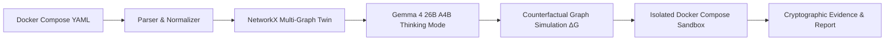

# 🛡️ NeuroSyn Sentinel Twin

> **Test Tomorrow's Infrastructure Decisions Today.**
> An AI-native digital twin for container infrastructure that models multi-relationship network topology, predicts security blast radius using Gemma 4 Thinking Mode, and verifies counterfactual reachability policies in disposable, isolated Docker sandboxes.

[](https://opensource.org/licenses/Apache-2.0)
[](https://python.org)
[](https://fastapi.tiangolo.com)
[](https://nextjs.org)
[-4285F4.svg?logo=google&logoColor=white)](https://ai.google.dev/gemma)
[](https://docker.com)

---

## ⚡ The Problem

Modern microservice architectures built on Docker Compose and Kubernetes often suffer from **flat network sprawl**:
1. Frontend containers often share default bridge networks with sensitive backend databases or payment vaults.
2. Configuration changes to network boundaries are made blindly, risking service outages or undetected lateral movement pathways.
3. Security audits rely on static linters or synthetic mocks rather than real container runtime verification.

---

## 💡 The Solution: Sentinel Twin

Sentinel Twin creates an **executable digital twin** from any Docker Compose configuration:



1. **Reconstruct Infrastructure Twin**: Ingests arbitrary Compose YAML and builds a multi-relationship graph (distinguishing shared networks, published host ports, and orchestration dependencies) via NetworkX.
2. **Propose & Simulate Counterfactuals**: Leverages Google DeepMind's **Gemma 4 26B A4B (MoE)** with full 256K context and Thinking Mode to audit attack surfaces and synthesize least-privilege allow/deny policies.
3. **Verify in Disposable Sandbox**: Automatically strips dangerous host bindings/volumes, provisions an isolated Docker network namespace, and executes live TCP probes (`nc -zv`) to prove policies hold true at runtime before teardown.
4. **Cryptographic Proof of Verification**: Generates exportable Markdown, JSON, and unified configuration diffs with SHA-256 integrity hashes.

---

## 🚀 Architecture & Tech Stack

### 🧠 Backend Engine (FastAPI & Python 3.11+)
* **Compose Parser (`engine/compose_parser`)**: Sanitizes and normalizes multi-service compose specifications; flags insecure host bindings.
* **Graph Engine (`engine/graph_engine`)**: Uses NetworkX to compute baseline and candidate reachability matrices ($R_0 \to R_1$).
* **Gemma 4 Adapter (`engine/policy_engine`)**: Connects to Google AI Studio (`gemma-4-26b-a4b-it`), Local Ollama (`gemma4:26b`), or offline fallback. Captures step-by-step thinking traces and latency telemetry.
* **Sandbox Runner (`engine/sandbox_runner`)**: Orchestrates isolated disposable Docker Compose projects with guaranteed `finally` teardown.
* **Evidence Collector (`engine/evidence`)**: Computes SHA-256 hashes of test execution logs and candidate YAML diffs.

### 💻 Web Application (Next.js 14 & React)
* **Interactive Topology Canvas**: Powered by `@xyflow/react` for visual inspection of network boundaries and dynamic counterfactual edge diffs ($\Delta G = G_1 - G_0$).
* **Execution Workspace**: Live comparison matrix displaying **Predicted (Graph Model)** vs. **Observed (Docker Runtime)** exit codes.
* **Telemetry Dashboard**: Real-time Section 17 telemetry metrics backed directly by SQLite.

---

## 📦 Quickstart

### Prerequisites
* Python 3.11+
* Node.js 18+
* Docker Desktop (running)

### 1. Clone & Configure Environment
```bash
git clone https://github.com/Muaviatanveer/sentinental-twin.git
cd sentinental-twin
cp .env.example .env
```

### 2. Start Backend API
```bash
python3 -m venv .venv
source .venv/bin/activate
pip install -r apps/api/requirements.txt
uvicorn apps.api.app.main:app --host 0.0.0.0 --port 8000 --reload
```

### 3. Start Frontend Dashboard
```bash
cd apps/web
npm install
npm run dev
```

Visit **http://localhost:3000** in your browser.

---

## 🧪 Automated QA Suite

Sentinel Twin features a 4-level test suite:
* **Level 1**: Compose Parser & Security Linter
* **Level 2**: NetworkX Graph Engine Reachability
* **Level 3**: Policy Synthesizer & Conflict Validation
* **Level 4**: End-to-End API Workflow

```bash
PYTHONPATH=. pytest apps/api/tests/test_sentinel_suite.py -v
```

---

## 🎯 Live Hackathon Demonstration Fixtures

Sentinel Twin includes two real demo fixtures:
1. **`fixtures/real-commerce-app`**: 3-tier Python Flask frontend + FastAPI API + PostgreSQL database with live products and an intentional direct DB vulnerability check.
2. **`fixtures/fintech-enterprise`**: Multi-service enterprise banking architecture featuring API gateway, auth, orders, and payment vault isolated under PCI-DSS boundaries.

---

## 📄 License

Apache License 2.0. Built for Google Antigravity & Gemma Hackathon 2026.
